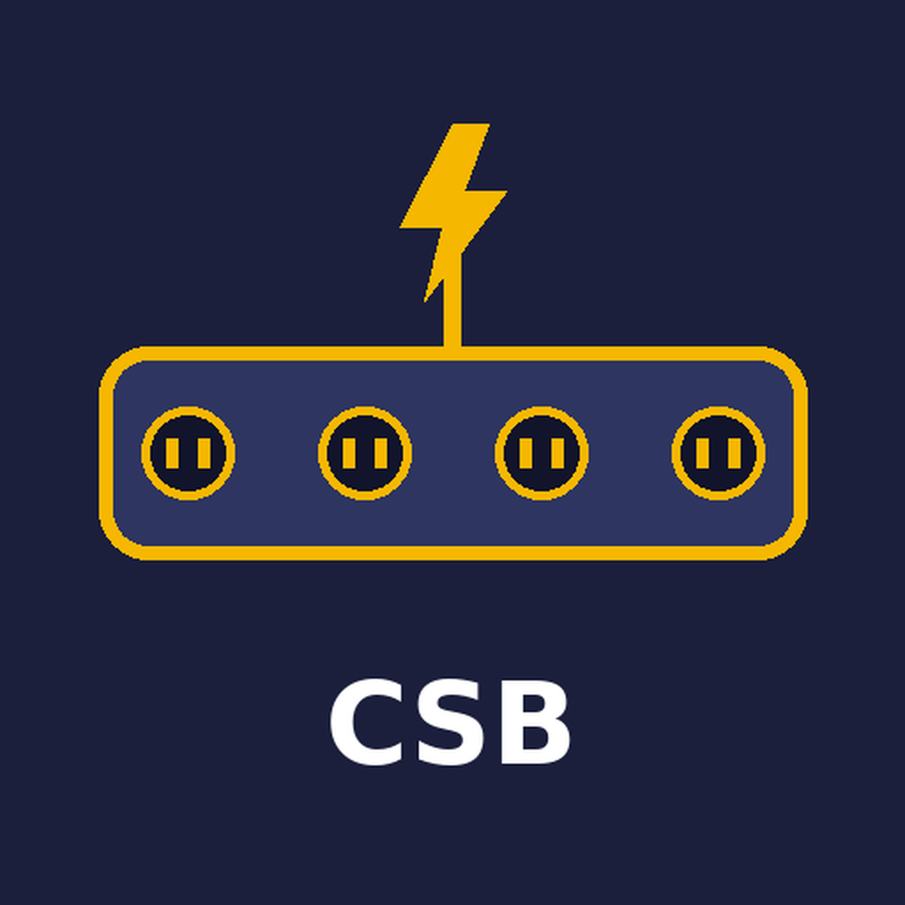

# Creative Switchboard

Creative Switchboard is a free switchboard that routes projects between creative tools: video editing, audio, music generation, image generation, animation and 3D, design, voiceover and subtitles, mastering and more. It moves work through open formats (OTIO, FCPXML, AAF, EDL, WAV and others), a Dropbox hub and each vendor's official, allowed methods. Social platforms are only downstream posting targets; the switchboard works upstream, between the tools where the work is made.

Think of it like a surge protector for creative software, worded truthfully: open formats and local files need no vendor permission, while cloud tools connect only through your own sign-in and the vendor's official methods.



## Project status: done, pending, uncertain
**Done**
- 2026-10-20: v1.0.4 pins tested OpenTimelineIO versions, marks AAF output UNVERIFIED (read-back failed in testing), removes duplicate README sections, adds multi-language answers and 20 translated summaries (machine-made, not yet native-reviewed); Dropbox round-trip re-test PASS.
- 2026-10-15: v1.0.3 adds Installation, Testing and License sections, clearer adapter install steps, and an EDL single-track warning (found by testing: EDL output drops the audio track without an error).
- 2026-10-15: v1.0.2 fixes the inspect command (`otiostat`, not `otioinfo`). End-to-end test on v1.0.1 passed (OTIO to FCPXML, Dropbox round trip byte-identical).
- 2026-10-15: v1.0.1 adds Google and Meta tools back to the allowlist (not yet checked).
- 2026-10-15: v1.0.0 built and tested (manifest, frontmatter, file links, skill and example consistency).
- 2026-10-15: allowlist of 138 tools in 10 categories; 25 checked against vendor docs, a second source or a connected connector.

**Pending**
- 41 tools are not yet checked; verify each against the vendor's docs before relying on it.
- How the counts fit: 138 unique tools (139 rows; Frame.io is listed twice). At launch 25 were checked and 113 were not (25 + 113 = 138). Each check moves a tool from "not yet checked" to "checked"; the total stays 138.
- Cloud tools need the user's own sign-in (OAuth or API key); nothing connects without it.
- Vimeo (free accounts need manual upload-access approval, up to 5 business days) and TikTok (unaudited apps post privately only; public posting needs an audit) have review delays.
- DaVinci Resolve scripting and its MCP server need the paid Studio version (21.1). Premiere Pro and Final Cut Pro are export-only routes (files, not live control).
- CapCut: no public API found. SoundCloud: API needs the paid Artist Pro plan. Spotify: no upload API (distributors only).
- Runway, Krea and ElevenLabs generation spends credits; never run without approval.
- Ableton Live: not checked. Lighting, camera, SFX library, mastering and instrument tools: not yet researched.
- Marketplace review: submitted 2026-10-15 (v1.0.3), pending, no approval yet.
- AAF: `otioconvert` writes an AAF file, but reading it back with `otiostat` failed in testing (pyaaf2 "stream does not exists: /referenced properties"). AAF output is UNVERIFIED; prefer OTIO or FCPXML.

**Uncertain**
- X API: possibly pay-per-use for new developers; not confirmed on X's own docs.
- DaVinci Resolve OTIO import: not confirmed in the Resolve manual.
- How the listing works on the Grok Bot and Grok side: not described in the publisher terms.


## Quick start
1. Install (see Installation).
2. Ask: "Move my Premiere timeline to DaVinci Resolve and send the dialogue to Audacity."
3. Get a route (most open method first), the steps, a verification of the result, and a list of anything lost or unchecked.

## Installation
1. Copy this repository (https://github.com/OmnipotentCEOxJenny/creative-switchboard) to `~/.cursor/plugins/local/creative-switchboard/`, or install from the marketplace once listed (Cursor plugin format: `.cursor-plugin/plugin.json`, `skills/`, `rules/`).
2. Optional, for timeline conversion: `pip install "opentimelineio==0.18.1" "otio-fcpx-xml-adapter==1.0.0" "otio-cmx3600-adapter==1.0.0"` (add `"otio-aaf-adapter==2.0.0"` for AAF). Versions are pinned to the ones tested (Python 3.13); newer versions may rename commands. All free and open source.

## Testing
```
otiostat sample.otio
otioconvert -i sample.otio -o sample.fcpxml
otiostat sample.fcpxml
otioconvert -i sample.otio -o sample.edl
otiostat sample.edl
```
Expected: FCPXML matches the source's track count, clip count and total duration. EDL keeps the duration but only one track (EDL is single-track).

## Credits
- Inventor and publisher: Rob Domaine / Omnipotent Media LLC
- Builder: Jenny Echo

## Rob Domaine's four pillars
1. Trustworthy, honest, real data, truthful: never invent; anything unchecked is marked UNVERIFIED.
2. Use only legitimate means: legitimate, proven sources and methods; unreliable sources rejected.
3. Double-check everything: every finding is confirmed by two independent checks, and the report shows both.
4. Stay within the law and rules always: local, county, state, federal and platform rules.

## Components
- `skills/route-creative-project`: plans and runs a transfer, most open route first, and verifies the result.
- `skills/convert-timeline`: converts timelines with the free OpenTimelineIO tools and reports what survives.
- `skills/route-creative-project/references/allowlist.csv`: the full allowlist with methods, formats, paid-plan needs, terms limits, blockers and verification status.
- `rules/pillars-and-scope.mdc`: the pillars and scope.
- `examples/sample-route.md`: a planning example.

## Allowlist (138 tools; checked vs not yet checked)

### Video editing (16)
| Tool | Method | Status |
|---|---|---|
| DaVinci Resolve | Y: Python/Lua scripting + MCP server (21.1), Studio only | checked |
| Adobe Premiere Pro | Y: UXP plugins; exports FCPXML, AAF, OTIO | checked |
| Final Cut Pro | Y: FCPXML, Workflow Extensions, Apple Events | checked |
| iMovie | N: no public API known; exports to Final Cut | not yet checked |
| CapCut | N: no public editing API found | checked |
| Avid Media Composer | partial: Media Composer Extensions (panel SDK) for partners; Avid not onboarding new partners now | checked |
| Kdenlive | partial: open source, MLT XML projects; native OTIO import and export since 25.04 | checked |
| Shotcut | partial: open source, MLT XML | checked |
| OpenShot | Y: libopenshot Python API | not yet checked |
| Lightworks | partial | not yet checked |
| VEGAS Pro | Y: scripting API (C#) | not yet checked |
| HitFilm | N: DISCONTINUED by Artlist 15 Jan 2025; no new licenses, downloads or support | checked |
| Descript | Y: Descript API, open beta for all users since 16 Apr 2026 (token in Settings) | checked |
| Clipchamp | N: Microsoft, no public API known | not yet checked |
| Filmora | N | not yet checked |
| Frame.io (review) | Y: V4 REST API, OAuth via Adobe IMS | checked |

### Audio production / DAWs (14)
| Tool | Method | Status |
|---|---|---|
| Audacity | Y: mod-script-pipe (named pipes), ships with app | checked |
| Ableton Live | partial: Max for Live (Suite), unofficial remote scripts | checked |
| REAPER | Y: ReaScript (Lua 5.4, EEL2, Python) | checked |
| Logic Pro | partial: Scripter MIDI JS only | not yet checked |
| GarageBand | N | not yet checked |
| FL Studio | partial: MIDI scripting (Python) | checked |
| Pro Tools | Y: Pro Tools Scripting SDK (PTSL, gRPC), free to anyone with an Avid account | checked |
| Cubase / Nuendo | partial: MIDI remote API | not yet checked |
| Bitwig Studio | partial: controller API in JavaScript (.js) and Java (.bwextension) | checked |
| Ardour | Y: Lua scripting, open source | checked |
| LMMS | partial: open source | not yet checked |
| Studio One | N: no officially documented public scripting API | not yet checked |
| BandLab | N: no public API known | not yet checked |
| Adobe Audition | partial: CEP/ExtendScript (legacy) | not yet checked |

### Music generation (10)
| Tool | Method | Status |
|---|---|---|
| Suno | Y: official API at platform.suno.com | checked |
| Udio | N: no public API (Udio help center) | checked |
| Stable Audio | Y: Stability API | not yet checked |
| ElevenLabs Music | Y: ElevenLabs API (connected) | checked |
| Mubert | Y: self-serve REST API | checked |
| Soundraw | Y: self-serve API | not yet checked |
| AIVA | N | not yet checked |
| Boomy | N | not yet checked |
| Beatoven.ai | partial: API keys issued on request | checked |
| Loudly | Y: Music API (self-serve developer portal) | checked |

### Image generation (13)
| Tool | Method | Status |
|---|---|---|
| Midjourney | N: no API; automation prohibited (ToS and guidelines) | checked |
| Stability AI (SD) | Y: REST API | checked |
| Krea | Y: connected connector | checked |
| Adobe Firefly | Y: Firefly Services API | checked |
| Leonardo.ai | Y: API | checked |
| Ideogram | Y: API | checked |
| OpenAI image models | Y: API | not yet checked |
| Google Imagen / Gemini | Y: Gemini API (Imagen) | checked |
| Meta AI image | N: no public image API known | not yet checked |
| Grok Imagine (xAI) | Y: xAI API | checked |
| Recraft | Y: API | checked |
| Playground | N: no self-serve API; select business partners only (Pro Plus on request) | checked |
| ComfyUI (local) | Y: local HTTP API, open source | checked |

### AI video (13)
| Tool | Method | Status |
|---|---|---|
| Runway | Y: connected connector | checked |
| Luma (Dream Machine/Ray) | Y: API, pay-as-you-go ($0.15+ per 5 s) | checked |
| Pika | Y: API, no free generation tier | checked |
| Krea video | Y: connected connector | checked |
| Kling | Y: API | checked |
| Hailuo / MiniMax | Y: API | checked |
| OpenAI Sora | N: Videos API and Sora 2 models shut down 24 Sep 2026 | checked |
| Google Veo | Y: Gemini API / Vertex AI | checked |
| Synthesia | Y: API | checked |
| HeyGen | Y: API | checked |
| D-ID | Y: API | checked |
| Haiper | N: consumer app shut Feb 2025; enterprise/B2B only | checked |
| Kaiber | N | checked |

### Animation / 3D / motion (14)
| Tool | Method | Status |
|---|---|---|
| Blender | Y: built-in Python API (bpy) | checked |
| Adobe After Effects | partial: ExtendScript/CEP; UXP in private beta (public beta planned Nov 2026) | checked |
| Cinema 4D | Y: Python SDK | checked |
| Autodesk Maya | Y: Python/MEL | not yet checked |
| Houdini | Y: Python (hou) | checked |
| Unreal Engine | Y: Python/Blueprint, Remote Control API | checked |
| Unity | Y: C# Editor scripting | not yet checked |
| Spline | partial: API/export | checked |
| Rive | Y: MIT open-source runtimes; editor free | checked |
| LottieFiles | partial: LottieFiles GraphQL API 'coming soon'; hosted MCP server; Lottie search/download via IconScout API | checked |
| Toon Boom Harmony | partial: Qt Script (JavaScript) scripting plus a Python interface | checked |
| Synfig | partial: open source | not yet checked |
| Moho | partial: Lua scripting | not yet checked |
| Adobe Animate | partial: JSFL | not yet checked |

### Graphics / design (12)
| Tool | Method | Status |
|---|---|---|
| Canva | Y: Connect API + Apps SDK (connected) | checked |
| Figma | Y: REST API, OAuth2 or tokens | checked |
| Adobe Photoshop | Y: UXP plugins; Photoshop API (Firefly Services) | checked |
| Adobe Illustrator | partial: ExtendScript/UXP | not yet checked |
| Affinity apps | Y: new Affinity (by Canva) has in-app scripting with a JS SDK | checked |
| GIMP | Y: GIMP 3 Python plug-ins (GObject Introspection), open source | checked |
| Inkscape | Y: extensions + CLI, open source | not yet checked |
| Krita | Y: Python scripting, open source | checked |
| Photopea | partial: URL/JSON API | not yet checked |
| Sketch | partial: plugin API | not yet checked |
| Penpot | Y: API, open source | checked |
| Adobe Express | partial: add-ons SDK (free/paid add-ons); Express API in beta, needs Firefly Services, no commercial use | checked |

### Subtitles / voice (12)
| Tool | Method | Status |
|---|---|---|
| ElevenLabs | Y: API (connected) | checked |
| Whisper (open source) | Y: local, open source (MIT) | not yet checked |
| Subtitle Edit | partial: CLI, open source | checked |
| Aegisub | partial: Lua automation, open source | checked |
| Rev | Y: API | checked |
| Otter.ai | Y: public API for Enterprise workspaces only | checked |
| AssemblyAI | Y: API | checked |
| Deepgram | Y: API | checked |
| Murf | Y: API | checked |
| Resemble AI | N for voice: no longer sells voice generation or cloning; APIs now deepfake detection, watermarking, identity | checked |
| Kapwing | partial: no public REST API; whitelisted Plugin API only | checked |
| Veed | Y: public REST API (Fabric 1.0, lipsync, subtitles, background removal) | checked |

### Storage / transfer hubs (11)
| Tool | Method | Status |
|---|---|---|
| Dropbox | Y: API (connected) | checked |
| Box | Y: API | checked |
| OneDrive | Y: Microsoft Graph | checked |
| Google Drive | Y: Drive API, user OAuth | not yet checked |
| iCloud Drive | N: no public file API | not yet checked |
| WeTransfer | N: Public API retired (disabled May 2022); only Enterprise activity-log API | checked |
| MASV | Y: API | not yet checked |
| pCloud | Y: API | not yet checked |
| MEGA | Y: C++ SDK (BSD 2-Clause) | checked |
| Backblaze B2 | Y: S3-compatible API | checked |
| Local disk / NAS | Y: file system | not yet checked |

### Export / distribution (23)
| Tool | Method | Status |
|---|---|---|
| Vimeo | Y: API upload, OAuth upload scope | checked |
| TikTok | Y: Content Posting API | checked |
| X | Y: API v2 media upload | checked |
| SoundCloud | Y: API upload via OAuth | checked |
| Spotify for Artists | N: no upload API; distributors only | checked |
| Bandcamp | partial: API for labels/partners on request | checked |
| YouTube | Y: YouTube Data API upload, user OAuth | not yet checked |
| Instagram / Reels | Y: Instagram Graph API publishing (professional accounts) | not yet checked |
| Facebook | Y: Graph API video publishing to Pages | not yet checked |
| Threads | Y: Threads API publishing | not yet checked |
| Twitch | N for upload: Kraken upload endpoints shut 28 Feb 2022, Helix Videos has no upload | checked |
| Dailymotion | Y: upload API (upload sessions, video.manage scope) | checked |
| Rumble | partial: upload API only for Rumble PRO subscribers | checked |
| Apple Music | N: distributors only | checked |
| Amazon Music | N: distributors only | not yet checked |
| DistroKid | N: no public API known | checked |
| Audiomack | partial: data/playback API (OAuth 1.0a); no public upload API found | checked |
| LinkedIn | Y: API (approval) | checked |
| Pinterest | Y: API (approval) | checked |
| Bluesky | Y: AT Protocol, open | not yet checked |
| Mastodon | Y: open API | not yet checked |
| PeerTube | Y: REST API with video upload (incl. resumable) | checked |
| Archive.org | Y: S3-like API | checked |

## Requirements
Free tools only by default (OpenTimelineIO, local apps, Dropbox free plan). No paid APIs required.

## Languages
The AI answers in the user's language and keeps commands, file names and status labels unchanged. Title, description and honest-assessment summaries in 23 languages are in [TRANSLATIONS.md](TRANSLATIONS.md): Español, Français, Português, Deutsch, Italiano, Nederlands, Polski, Русский, Українська, Türkçe, العربية, עברית, فارسی, हिन्दी, বাংলা, اردو, 简体中文, 日本語, 한국어, Bahasa Indonesia, Tiếng Việt, Kiswahili, Tagalog / Filipino. They are machine translations, not yet reviewed by native speakers; the English text is authoritative.

## Feedback and reviews
- Reviews and feedback: [Discussions](https://github.com/OmnipotentCEOxJenny/creative-switchboard/discussions)
- [Report a wrong route or tool fact](https://github.com/OmnipotentCEOxJenny/creative-switchboard/issues/new?template=wrong-route.md)
- [Feature request](https://github.com/OmnipotentCEOxJenny/creative-switchboard/issues/new?template=feature-request.md)

## License
MIT. See `LICENSE`. Copyright Rob Domaine / Omnipotent Media LLC.

## Honest assessment: what this plugin cannot do
Written to be fully transparent. If something here is wrong or out of date, please open an issue.

- It does not control creative apps by itself. It routes work through open file formats, Dropbox and each vendor's official methods, and cloud tools need your own sign-in.
- 41 of the 138 allowlisted tools are not yet checked against vendor docs.
- AAF: files can be written, but reading them back with the free tools failed in testing, so AAF output is UNVERIFIED. Prefer OTIO or FCPXML.
- EDL keeps only one track; other tracks (such as audio) are dropped without an error.
- Premiere Pro and Final Cut Pro are export-only routes. DaVinci Resolve scripting needs the paid Studio version. CapCut has no public API found, Spotify has no upload API, and SoundCloud's API needs a paid plan.
- It never runs credit-spending generation (Runway, Krea, ElevenLabs) without your approval.
- Marketplace: v1.0.3 submitted 2026-10-15 and still pending review; it is not an approved listing yet.
- Translations: the 23 translated summaries in [TRANSLATIONS.md](TRANSLATIONS.md) are machine-made and have not been reviewed by native speakers. The English text is authoritative.
- It is not legal advice and cannot guarantee that any particular use is lawful; you remain responsible for how you use it.
- Rules and compliance: it is built to follow all local, county, state and federal laws and every platform's rules. It uses no paid services, never bypasses logins, paywalls, CAPTCHAs or access controls, and never claims a feature it does not have.
